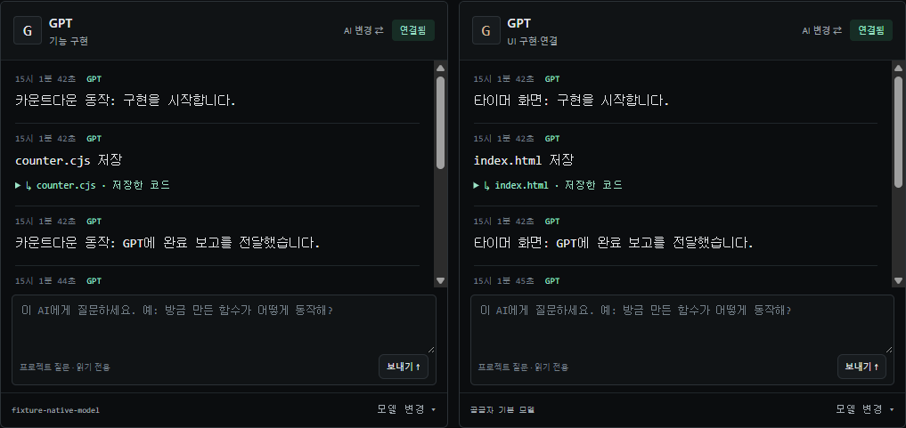

<p align="center">
  
</p>

# CW_Handsoff_sys · Hands off System

Windows x64 · v0.1.8

**프로젝트 폴더 하나에서 AI에게 일을 나눠주고, 시안 승인부터 테스트 결과 확인까지 이어가는 데스크톱 앱입니다.**

GPT에 적은 요구사항을 Claude나 다른 에이전트에게 옮겨 붙이고, 구현 결과를 다시 가져와 테스트하는 일이 번거로웠다면 Hands off에 작업을 한 번 설명해 보세요. 맨 위의 **컨트롤 타워**가 /Fun으로 요구사항과 완료 기준을 정리한 뒤, 구현·UI·테스트 역할을 맡은 AI에 일을 전달합니다. 각 AI가 한 일과 검증 결과를 같은 화면에서 확인할 수 있습니다.

**흐름·집중 보기**에서는 작업 노드와 연결선으로 진행을 확인하고, 선택한 AI의 실제 출력과 채팅을 아래에서 읽습니다. 오른쪽 **지금 필요한 작업**에는 시안 승인이나 실행 권한처럼 다음에 해야 할 일이 표시됩니다.

| 이런 일을 하고 싶다면 | Hands off에서 할 수 있는 일 |
| --- | --- |
| 여러 AI에게 같은 설명을 반복하고 싶지 않을 때 | 역할을 한 번 배정하고 컨트롤 타워에 요청을 보냅니다. |
| 코드가 만들어지기 전에 화면을 보고 싶을 때 | UI 시안을 미리 보고 승인하거나, 바꾸고 싶은 부분을 채팅으로 요청합니다. |
| 테스트가 실제로 무엇을 확인했는지 알고 싶을 때 | 테스트별 통과·실패, 재현 절차, 담당 AI의 수정 과정을 봅니다. |
| AI 수정 전 상태로 돌아가고 싶을 때 | 체크포인트에서 되돌릴 파일을 확인하고 복원합니다. |
| 검증한 코드를 GitHub나 Vercel에 보내고 싶을 때 | 프로젝트별 대상과 계정을 확인한 뒤 푸시 또는 배포를 승인합니다. |

## 처음 실행하기

현재 GitHub에서 소스를 내려받아 Windows에서 실행할 수 있습니다. Git, Node.js 24 이상, 그리고 사용할 AI의 공식 CLI가 필요합니다. 첫 시도에는 **이미 쓰고 있는 AI 계정 하나**면 됩니다.

```powershell
git clone https://github.com/ccw00325-spec/Hands_off_system.git
cd Hands_off_system
npm ci
npm start
```

앱이 열리면 첫 실행 안내가 나옵니다. **다음**으로 버튼의 쓰임을 살펴보거나 **건너뛰기**를 누를 수 있습니다. 상단의 **Hands off 가이드**에서 언제든 다시 열 수 있습니다.

> 첫 작업 예시
>
> “1초부터 3,600초까지 설정할 수 있는 웹 타이머를 만들어줘. 시작·일시정지·초기화를 넣고, 일시정지하면 숫자가 멈추는지 테스트해줘. 마지막에 실행 방법도 알려줘.”

1. **새 프로젝트**를 눌러 빈 폴더를 고르고 접근 범위를 확인합니다. 생성된 파일은 이 폴더에 저장됩니다.
2. **계정 · 연결**에서 사용할 AI를 연결합니다. **AI 역할 변경**에서 작업 패널을 2개로 설정하고 같은 AI를 양쪽에 배치합니다. 첫 패널에 **컨트롤 타워**와 **테스트 설계·실행**, 두 번째 패널에 **기능 구현**과 **UI 구현·연결**을 맡긴 뒤 **역할 배치 저장**을 누릅니다.
3. 이미지 API 키 없이 먼저 실행하려면 **설정 → UI 작업 전 시안 생성 및 승인 대기**를 끕니다. 테스트도 직접 실행해 보려면 신뢰하는 예제 폴더에서 **승인한 폴더의 테스트·검증 코드 실행 활성화**를 켜고 **현재 폴더 코드 실행 승인**을 누릅니다.
4. 컨트롤 타워에 예시를 붙여 넣고 **작업 요청**을 누릅니다. 오른쪽 **실행 현황**에서 결과를 확인하고, 작업 보고에 나온 실행 방법으로 타이머를 열어 봅니다.

## 화면별로 익히기

아래는 실제 앱을 예제 프로젝트와 모의 연결 상태로 실행한 화면입니다. UI 시안 화면의 타이머 이미지는 미리보기 흐름을 보여주기 위해 넣은 예시입니다.

### 1. 작업 공간에서 요청 보내기


컨트롤 타워의 안내를 읽고 오른쪽 버튼으로 다음 단계로 이동합니다. 시안 승인이 필요하면 **UI 시안 열기**, 테스트 실행 동의가 필요하면 **실행 권한 설정**이 나타납니다. 연결선은 계획된 작업의 선행 조건을 따릅니다. 먼저 필요한 작업이 끝나야 다음 작업이 시작됩니다.

| 어디를 누르나요? | 무엇을 하나요? |
| --- | --- |
| 상단 **프로젝트** / **새 프로젝트** | 기존 작업으로 전환하거나 새 작업 폴더를 선택합니다. |
| 왼쪽 **대화 검색** / **새 대화** / **기록 관리** | 같은 프로젝트의 이전 대화를 찾거나 새 대화를 엽니다. 기록 관리에서는 대화를 보관·내보내기·삭제할 수 있습니다. |
| 가운데 **이름 편집** | 프로젝트 목록에 보이는 이름을 바꿉니다. |
| **작업 노드** | 해당 작업을 맡은 AI의 출력을 선택하고, 오른쪽에 작업 상태·변경 파일·완료 보고를 표시합니다. |
| **흐름·집중 보기** / **모든 AI 패널** | 그래프와 AI 하나에 집중하거나 여러 AI 출력을 동시에 펼칩니다. |
| **AI 작업 출력**의 AI 버튼 | 읽고 싶은 AI의 실제 출력과 개별 채팅 입력창으로 전환합니다. |
| **출력 크게 보기** | 그래프를 접고 출력 공간을 늘립니다. **흐름 함께 보기**로 돌아올 수 있습니다. |
| 가운데 **작업 요청** / **질문만** | 작업 요청은 구현을 시작합니다. 작업 중에는 질문 모드로 전환되며, 코드 변경 없이 설명을 요청할 수 있습니다. |
| 입력창 옆 **목록 불러오기** | 지원하는 실행 모델 목록을 엽니다. GPT 패널에서 `/model`을 입력해도 열 수 있습니다. |
| **작업 중지** | 현재 진행 중인 작업을 멈춥니다. 이미 적용한 변경은 체크포인트에서 확인할 수 있습니다. |
| 오른쪽 **실행 현황** / **체크포인트** | 각 역할의 진행 상태, 테스트 결과와 복원할 수 있는 변경을 봅니다. |

상단 사용량에는 지원되는 계정의 **5시간·주간 잔여 한도**가 따로 표시됩니다. 오른쪽 **이번 작업 사용량**에서는 AI별 호출 수와 조회 가능한 토큰을 확인할 수 있습니다.


**완료 보고**는 담당 AI가 구현을 제출했다는 뜻입니다. **작업 완료**는 실행 검증과 최종 검토까지 통과했을 때 표시됩니다. 체크포인트를 복원하면 이전 검증 결과가 해제되어 다시 확인해야 합니다.

### 2. AI를 연결하고 역할 나누기


**계정 · 연결**에서 기존 로그인 상태를 확인하고, **AI 역할 변경**에서 실제 작업에 쓸 패널과 역할을 정합니다.

| 연결할 AI | 사용 방법 |
| --- | --- |
| GPT | 공식 Codex CLI의 ChatGPT 로그인 상태를 확인합니다. |
| Claude | 공식 Claude Code에 로그인합니다. |
| Grok | Cursor Agent CLI에 로그인하고, 계정에서 제공되는 Grok 모델을 선택합니다. |
| Gemini | Gemini CLI에서 Google 계정으로 로그인합니다. |

**작업 패널 수**는 2~4개로 정할 수 있습니다. 첫 패널이 **컨트롤 타워**를 맡고, **기능 구현**, **UI 구현·연결**, **디버깅**, **코드 검토**, **테스트 설계·실행**은 작업에 맞게 배정합니다. 각 패널의 **AI 변경**으로 공급자나 모델을 다시 고를 수 있고, 아래 작업자 입력창에서 특정 구현이나 코드에 대해 직접 질문할 수 있습니다. 같은 계정을 여러 패널에 배치하면 사용 한도도 공유합니다.

<details>
<summary>계정 연결과 작업자 화면 보기</summary>


**전체 연결 다시 확인**을 누르면 공식 CLI 로그인 상태와 앱에 등록한 연결을 다시 조회합니다. UI 시안을 생성하려면 GPT Image 또는 Gemini 이미지용 개인 API 키를 등록합니다. 이미지 API 사용량과 비용은 해당 공급자 계정에 따로 반영됩니다.



</details>

### 3. UI 시안을 확인하고 수정하기


UI 작업이 포함되고 시안 승인 설정이 켜져 있으면, 컨트롤 타워가 시안을 만든 뒤 승인까지 기다립니다. 박스를 든 캐릭터가 왼쪽 **UI 시안**으로 안내합니다.

- 그래프의 **UI 시안** 노드, 컨트롤 타워의 버튼, 오른쪽 **UI 시안 열기** 중 편한 곳을 누릅니다.
- **모델 변경**에서 GPT Image 또는 Gemini Flash Image를 선택합니다. 키가 필요하면 **API 키 연결**을 누릅니다.
- 입력란에 “시간 숫자를 더 크게”처럼 바꿀 내용을 적고 **시안 생성**을 누릅니다. 컨트롤 타워에서도 `시안 수정: 시간 숫자를 더 크게`라고 보낼 수 있습니다.
- 마음에 들면 **컨트롤 타워로 돌아가기**를 눌러 `이대로 적용`을 보냅니다. 파일로 보관할 때는 **PNG 내보내기**를 사용합니다.

### 4. 테스트 결과를 읽고 필요하면 복원하기


**테스트 설계·실행** 역할을 배정하면 요구사항을 실제 테스트 코드와 연결하고 재현 절차를 남깁니다. 실행 권한을 승인한 폴더에서는 Node 내장 테스트나 지정한 npm 스크립트로 결과를 확인합니다. 실패하면 오른쪽 실행 현황에 실패 항목과 담당 AI가 표시됩니다. 컨트롤 타워는 **설정 → 자동 수정 최대 횟수** 안에서 수정과 재실행을 요청합니다. 같은 실패가 반복되거나 테스트 자체에 문제가 있다고 판단되면 사용자 확인을 요청합니다. 실행 권한이 필요하면 오른쪽 안내 버튼으로 설정을 열 수 있습니다.

- **결과·재현 절차**에서 각 테스트의 결과와 실행 명령을 확인합니다. 필요한 경우 **테스트 다시 실행**을 누릅니다.
- AI 연결이나 구현 도중 중단되면 **문제 작업 출력 보기**로 담당 AI의 로그와 변경 내역을 확인합니다.
- **체크포인트**에서 복원 지점과 영향을 받을 파일을 미리 봅니다. 사용자가 이후 수정한 파일과 충돌하면 복원을 멈춥니다.
- **검증 옵션 → 뮤테이션 테스트**는 기본 테스트 통과 후 작은 코드 변형을 넣어 테스트가 실제 오류를 잡는지 확인합니다. StrykerJS와 프로젝트의 `test:mutation` 스크립트를 미리 설정해야 합니다.

<details>
<summary>체크포인트와 실행 권한 화면 보기</summary>


</details>

### 5. GitHub로 푸시하거나 Vercel에 배포하기


상단의 **보조 서비스 연결**에서 공식 CLI 로그인 상태를 확인하고, 필요한 서비스만 현재 프로젝트에 설정합니다.

| 서비스 | 설정하면 할 수 있는 일 |
| --- | --- |
| GitHub | 검증된 코드를 커밋·푸시합니다. 새 저장소가 필요하면 이름을 정하거나 컨트롤 타워의 제안을 받아 비공개 저장소를 만들 수 있습니다. |
| Vercel | 연결한 계정 또는 팀의 프로젝트에 미리보기로 배포합니다. 운영 배포는 따로 선택합니다. |
| Supabase | 계정 연결을 확인하고 프로젝트 참조 ID를 저장합니다. 프로젝트 연결과 DB 마이그레이션은 Supabase CLI에서 진행합니다. |

검증이 끝나면 앱이 **전송 대상**과 함께 진행 여부를 묻습니다. **예**는 이번 작업을 전송하고, **아니요**는 해당 서비스만 건너뜁니다. **다음부터 묻지 않기**는 같은 프로젝트와 같은 대상에서만 적용되며 설정에서 해제할 수 있습니다. 네트워크 오류가 나면 로컬 작업을 확인하고 실패한 전송 단계만 다시 시도할 수 있습니다.


## 실행 권한과 데이터

프로젝트 파일은 선택한 폴더에 저장됩니다. AI가 작업에 필요한 소스를 읽거나 전달하는 범위는 폴더 연결 시 확인할 수 있습니다. 앱에 등록한 API 키는 OS 보안 저장소로 암호화하고, 공식 CLI 로그인은 현재 OS 사용자의 세션을 재사용합니다. 프로젝트 코드와 npm 스크립트는 **현재 OS 사용자 권한**으로 실행되므로 신뢰하는 폴더에서만 승인하세요. [보안과 릴리스 검증 절차](docs/security-release.md)

<details>
<summary>직접 빌드와 개발 검증</summary>

Windows에서 포터블 빌드를 만들면 `release/CW_Handsoff_sys 0.1.8.exe`가 생성됩니다.

```powershell
npm run package:win -- --config.compression=store
npm run check
npm test
npm run test:desktop
npm run verify:package
```

데스크톱 테스트는 예시 응답으로 버튼과 작업 흐름을 검사합니다. `test:timer:live`, `test:timer:qa:live`, `test:chat:live`는 실제 계정 사용 한도를 소비합니다. [검증 기록](VALIDATION.md) · [배포 관리 규칙](docs/release-policy.md)

Ubuntu x64에서 소스로 실행하려면 Linux용 Node.js와 npm, Electron GUI 런타임을 준비한 뒤 `npm ci`, `npm run check`, `npm test`, `npm start`를 실행합니다. AI CLI는 해당 Linux 사용자 환경에서 연결합니다.

</details>

<details>
<summary>고급 검증과 호출 한도</summary>

- **StrykerJS**는 프로젝트의 `test:mutation`을 `stryker run`에 연결합니다. `reporters`에 `json`을 추가하고, `jsonReporter: { fileName: process.env.TOWER_MUTATION_REPORT }`로 앱이 전달한 위치에 결과를 씁니다. `thresholds.break`는 `null`로 두고 `mutate`에는 핵심 로직을 지정합니다. PR 변경 파일만 검사하려면 프로젝트 스크립트에서 범위를 계산하세요.
- **사용량**은 지원하는 공급자와 호출만 집계합니다. GPT API 비용은 모델 ID와 토큰 단가를 입력한 경우 추정하며, 예산에 도달했거나 비용을 확인할 수 없으면 새 호출을 보류합니다. 진행 중인 요청은 예산을 넘을 수 있습니다.
- **변경 보호**는 위험한 파일 변경을 적용하기 전에 별도 검토하고, 기준 파일이 달라지면 적용을 보류합니다. 체크포인트 복원은 로컬 파일에 적용되며, 복원 이후 검증과 배포 승인은 다시 받아야 합니다. 프로젝트에서 Git을 사용한다면 `.control-tower/`를 버전 관리에서 제외하세요.

</details>
