<p align="center">
  
</p>

# CW_Handsoff_sys · Hands off System

Windows x64 · macOS arm64/x64 · v0.2.4

| 사용할 PC | 저장소와 빌드 |
| --- | --- |
| Windows x64 | [Window 저장소](https://github.com/ccw00325-spec/Hands_off_system_window) · [Windows 빌드·검증](https://github.com/ccw00325-spec/Hands_off_system_window/actions/workflows/platforms.yml) |
| MacBook · Apple Silicon / Intel | [Mac 저장소](https://github.com/ccw00325-spec/Hands_off_system_mac) · [Mac 빌드·검증](https://github.com/ccw00325-spec/Hands_off_system_mac/actions/workflows/platforms.yml) |

두 저장소는 같은 소스와 버전을 사용합니다. 업데이트는 양쪽에 함께 푸시하고, 각 OS에서 빌드·검증합니다. Mac의 `.dmg`·`.zip`은 ad-hoc 서명으로 빌드하며 **Apple Developer ID 서명·공증은 적용하지 않았습니다**. [설치·플랫폼 안내](docs/platform-setup.md)

v0.2.4 배포 파일: [Windows x64 다운로드가 있는 검증 실행](https://github.com/ccw00325-spec/Hands_off_system_window/actions/runs/42114719827) · [Mac Apple Silicon / Intel 다운로드가 있는 검증 실행](https://github.com/ccw00325-spec/Hands_off_system_mac/actions/runs/42114729397). 로그인 후 페이지 아래 **Artifacts**에서 자신의 환경에 맞는 파일을 받으세요. 패키지는 30일 보관하며 [검증 기록의 SHA-256](VALIDATION.md)으로 파일을 비교할 수 있습니다.

**만들고 싶은 앱을 설명하면, 역할을 맡은 AI들이 같은 작업 폴더에서 설계·구현·검증을 이어가는 PC용 작업 공간입니다.**

AI마다 같은 요구사항을 다시 설명하고, 한쪽에서 만든 코드를 다른 쪽으로 옮겨 붙이는 작업을 줄이려고 만들었습니다. Hands off의 **컨트롤 타워**에 요청을 보내면 내장 `/fun` 지침으로 기능과 완료 기준을 정리합니다. 그 기준을 기능 구현·UI·검토·테스트 담당에게 전달하고, 결과와 수정이 필요한 지점을 한 화면에서 확인합니다.

컨트롤 타워는 GPT·Claude·Gemini·Cursor 중에서 선택합니다. 사용할 AI가 하나뿐이라면 같은 계정을 여러 역할에 배치할 수 있고, 서로 다른 AI를 연결해 2~4개 패널로 나눠도 됩니다. 같은 계정을 여러 패널에서 쓰면 사용 한도도 공유합니다.

왼쪽에서 **폴더와 이전 대화**, 가운데에서 **컨트롤 타워 채팅**, 오른쪽에서 **AI별 진행 상황**을 봅니다. AI 로고를 누르면 담당 작업의 로그와 질문창이 열립니다. 자세한 흐름은 **Workflow 보기**, 시안 승인과 오류 안내는 상단 **종 아이콘**에서도 찾을 수 있습니다.

[처음 실행하기](#처음-실행하기) · [화면과 버튼 설명](#화면별로-익히기) · [검증 기록](VALIDATION.md) · [이용 조건](#라이선스와-이용-승인)

개인·학습·비상업적 연구용으로 수정하지 않은 앱을 무료로 사용할 수 있습니다. **원본 코드 수정·파생 개발·상업적 이용·모델 학습·파인튜닝은 사전 서면 승인이 필요합니다.** 문의: [ccw00325@gmail.com](mailto:ccw00325@gmail.com). 자세한 범위는 [LICENSE](LICENSE)를 확인하세요.

| 이런 일을 하고 싶다면 | Hands off에서 할 수 있는 일 |
| --- | --- |
| 여러 AI에게 같은 설명을 반복하고 싶지 않을 때 | 역할을 한 번 배정하고 컨트롤 타워에 요청을 보냅니다. |
| 작업 중 AI 사용 한도가 소진될 때 | 연결된 팀에서 사용 가능한 AI를 찾아 같은 작업과 완료 기준을 전달합니다. 사용할 AI가 없으면 저장한 코드를 보존하고 멈춥니다. |
| 코드가 만들어지기 전에 화면을 보고 싶을 때 | UI 시안을 미리 보고 승인하거나, 바꾸고 싶은 부분을 채팅으로 요청합니다. |
| 테스트가 실제로 무엇을 확인했는지 알고 싶을 때 | 테스트별 통과·실패, 재현 절차, 담당 AI의 수정 과정을 봅니다. |
| AI 수정 전 상태로 돌아가고 싶을 때 | 체크포인트에서 되돌릴 파일을 확인하고 복원합니다. |
| 검증한 코드를 GitHub나 Vercel에 보내고 싶을 때 | 프로젝트별 대상과 계정을 확인한 뒤 푸시 또는 배포를 승인합니다. |

## 처음 실행하기

빌드 파일을 사용할 때는 자신의 OS 저장소에서 성공한 **Actions 실행 → Artifacts**를 열어 Windows 실행 파일 또는 Mac 패키지를 받습니다. 아티팩트 다운로드에는 GitHub 로그인이 필요하고 보관 기간이 있습니다. GitHub의 README 페이지에서 앱이 웹 서비스처럼 실행되는 방식은 아닙니다.

앱 창을 여는 데 필요한 Electron 런타임은 패키지에 포함합니다. 첫 실행의 흰색 시작 창에서 **Git, Node.js 24+·npm, Docker와 선택한 AI CLI**를 점검합니다. 빠졌거나 오래된 도구가 있으면 준비 안내가 나타나고 **설치 안내 열기**를 누르면 공식 홈페이지가 열립니다. 설치 후 **설치 후 다시 확인**을 누르세요. 사용하지 않을 AI까지 모두 설치할 필요는 없습니다. 둘러보기를 먼저 할 수도 있습니다.

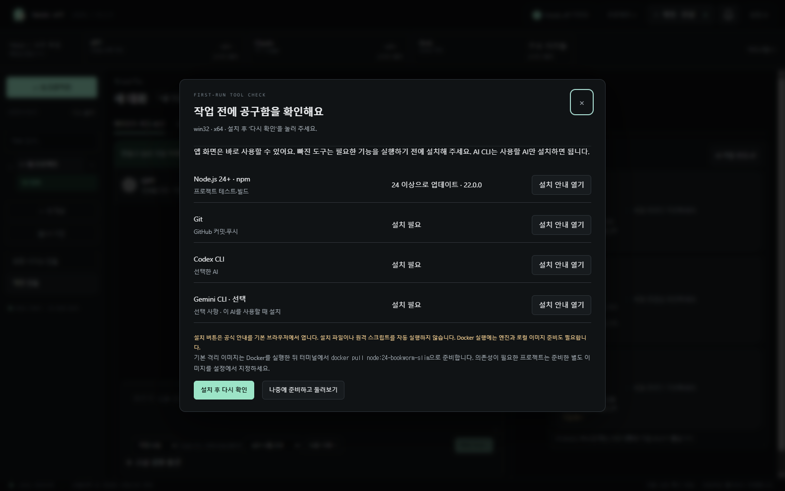

설치 안내는 실행 파일·원격 스크립트를 몰래 다운로드하거나 실행하지 않습니다. Node.js 설치에는 npm이 함께 제공되며, GitHub 전송에는 Git이 필요합니다. Docker 격리를 사용하려면 엔진과 로컬 Linux 이미지도 준비해야 합니다. 설정의 **설치 도구 확인**에서 언제든 재검사할 수 있습니다.

소스에서 직접 실행하려면 Git과 Node.js 24 이상을 먼저 설치한 뒤 아래 명령을 사용하세요. Mac에서는 clone 주소를 위 Mac 저장소로 바꾸면 됩니다.

처음에는 **이미 사용하는 AI 하나를 두 패널에 배치**해 시작할 수 있습니다. 이미지 시안 생성에는 별도 개인 API 키가 필요하며, AI 구독과 이미지 API 과금은 각각의 공급자 조건을 따릅니다. Hands off를 실행한다고 다른 사람의 AI 계정이나 개발자 키가 제공되는 것은 아닙니다.

```powershell
git clone https://github.com/ccw00325-spec/Hands_off_system_window.git
cd Hands_off_system_window
npm ci
npm start
```

### 처음 하는 작업은 이 순서로 진행하세요

1. **새 프로젝트**에서 결과물을 저장할 빈 폴더를 고릅니다.
2. **계정 · 연결**에서 사용할 AI의 로그인 상태를 확인합니다.
3. **AI 역할 변경**에서 AI·모델·담당 역할을 고릅니다. 최소 2개, 최대 4개 패널을 사용합니다.
4. 컨트롤 타워에 원하는 기능을 적고 **작업 요청**을 누릅니다. 시안 승인을 켰다면 화면을 확인하고 `이대로 적용`을 보냅니다.
5. **Workflow 보기**에서 검증 결과를 확인합니다. GitHub나 Vercel 전송은 연결한 프로젝트의 대상과 승인 여부를 확인한 뒤 진행합니다.

프로젝트 파일은 선택한 폴더에 생성됩니다. 테스트 코드 실행에는 해당 폴더의 실행 승인이 별도로 필요합니다. AI의 완료 보고와 실제 테스트 통과는 구분해서 표시합니다.

앱이 열리면 첫 실행 안내가 나옵니다. **다음**으로 버튼의 쓰임을 살펴보거나 **건너뛰기**를 누를 수 있습니다. 상단의 **Hands off 가이드**에서 언제든 다시 열 수 있습니다.

앱이 열리기 전에는 화면 중앙의 **흰색 시작 창**에서 로그인 상태, AI 모델 목록, 프로젝트와 화면을 준비합니다. 캐릭터가 돌에 걸렸다가 박스를 주워 다시 걷는 동안 준비 단계가 진행되고, 바가 100%가 되면 작업 창이 열립니다. 진행률은 남은 시간의 예측치가 아닌 준비 단계 기준입니다.

화면을 불러오는 중 일시적인 `ERR_FAILED (-2)` 또는 `ERR_ABORTED`가 발생하면 최대 2회 다시 시도합니다. 화면 로딩과 앱 초기화가 모두 끝난 뒤 작업 창을 표시하며, 복구 도중 시작 창을 닫으면 종료합니다. 파일이 없거나 접근이 차단된 오류는 숨기지 않습니다. 계속 실패한다면 앱 데이터 폴더의 `startup-diagnostics.json`에서 오류 코드와 시도 횟수를 확인할 수 있습니다. 이 기록에는 계정·키·대화·파일 경로를 넣지 않습니다. 소스 실행은 `.runtime`, Windows 배포판은 `%APPDATA%\agent-control-tower`에 저장합니다.

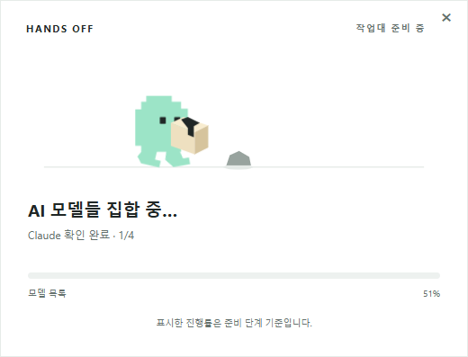

시작할 때 준비한 목록을 **계정 · 연결**, **AI 역할 변경**, **컨트롤 타워의 모델 선택**에서 공유합니다. 목록을 불러오는 버튼을 누를 필요 없이 바로 선택하세요. 앱에서 로그인이나 GPT 실행 계정을 바꾸면 자동 갱신합니다. 미연결 AI는 로그인 필요로, 조회 실패는 확인 실패로 표시하며 앱을 무한히 기다리게 하지 않습니다. Claude는 공식 CLI 별칭을 표시합니다.

**Hands off 가이드**에는 실제 앱 화면을 넣은 8개 주제가 있습니다. AI·모델 선택 용어부터 시안 승인, 테스트와 뮤테이션 설정, 체크포인트 복원, 외부 서비스 전송까지 단계별로 설명합니다. 각 주제의 바로가기 버튼으로 해당 기능을 직접 열 수 있습니다.

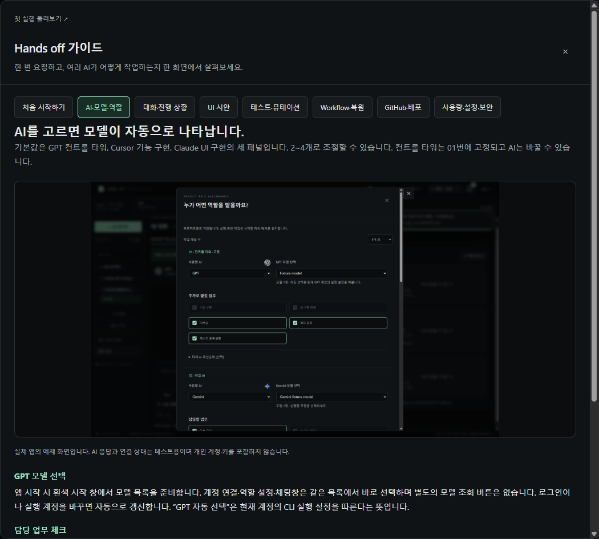

> 첫 작업 예시
>
> “1초부터 3,600초까지 설정할 수 있는 웹 타이머를 만들어줘. 시작·일시정지·초기화를 넣고, 일시정지하면 숫자가 멈추는지 테스트해줘. 마지막에 실행 방법도 알려줘.”

1. **새 프로젝트**를 눌러 빈 폴더를 고르고 접근 범위를 확인합니다. 생성된 파일은 이 폴더에 저장됩니다.
2. **계정 · 연결**에서 사용할 AI를 연결합니다. **AI 역할 변경**에서 작업 패널을 2개로 설정하고 같은 AI를 양쪽에 배치합니다. 첫 패널에 **컨트롤 타워**와 **테스트 설계·실행**, 두 번째 패널에 **기능 구현**과 **UI 구현·연결**을 맡긴 뒤 **역할 배치 저장**을 누릅니다.
3. 기본 시안은 **텍스트 구조안**이라 이미지 API 키가 없어도 됩니다. 테스트를 실행하려면 **Docker 격리**를 준비하고 **승인한 폴더의 테스트·검증 코드 실행 활성화**와 **현재 폴더 코드 실행 승인**을 확인하세요. 격리 모드는 Docker가 없을 때 PC에서 대신 실행하지 않습니다.
4. 컨트롤 타워에 예시를 붙여 넣고 **작업 요청**을 누릅니다. 오른쪽 AI 카드에서 진행 상태를 보고, **Workflow 보기**에서 테스트 결과를 확인합니다. 작업 보고에 나온 실행 방법으로 타이머를 열어 봅니다.

## 화면별로 익히기

작업 공간·역할 설정·가이드는 v0.2.4의 실제 앱을 예제 프로젝트와 모의 AI 응답·연결 상태로 실행해 캡처했습니다. 파일 저장과 Node 테스트는 실제로 실행했습니다. 사용 한도 소진도 오류를 주입해 재현했으며, 실제 유료 계정의 한도를 소진시킨 결과는 아닙니다. 시작 애니메이션과 타이머 이미지 시안은 이전 버전에서 확인한 같은 기능의 참고 화면입니다. 새 작업의 기본 시안은 위에서 소개한 텍스트 구조안입니다.

### 1. 작업 공간에서 요청 보내기

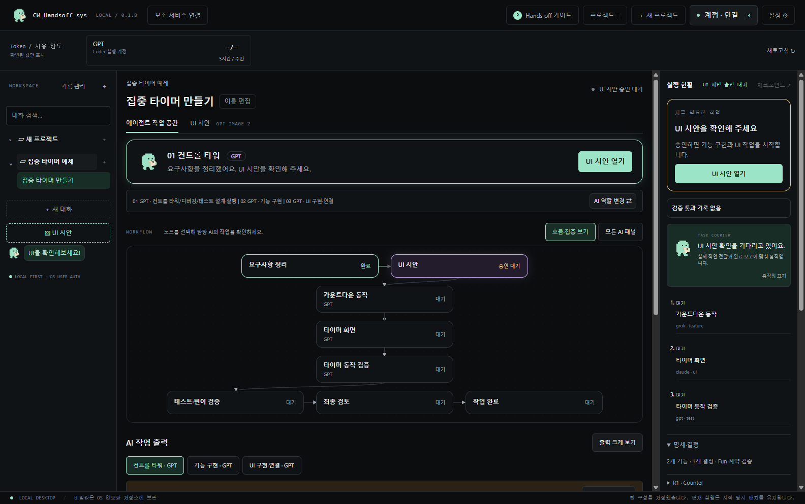

가운데 컨트롤 타워에 만들고 싶은 것을 적으세요. 대화 위 안내에는 시안 확인·테스트 결과처럼 **지금 할 일**이 나타납니다. 오른쪽 AI 카드에는 작업이 **대기 → 진행 중 → 구현 완료** 순서로 쌓이고, 전체 검증까지 통과하면 **완료**가 표시됩니다. 이전 작업은 접어서 볼 수 있습니다.

곡선은 컨트롤 타워와 각 작업자를 연결합니다. 실제 업무 배정과 완료 보고 이벤트가 발생하면 박스를 든 캐릭터가 곡선을 따라 양방향으로 이동합니다. 컨트롤 타워 자신의 카드는 같은 대화를 여는 바로가기이므로 점선으로 구분합니다. 움직임은 설정에서 끌 수 있습니다.

| 어디를 누르나요? | 무엇을 하나요? |
| --- | --- |
| 왼쪽 **새 프로젝트** / 폴더 이름 | 새 작업 폴더를 선택하거나 기존 프로젝트로 전환합니다. 상단 **프로젝트 ≡**는 사이드바를 접고 펼칩니다. |
| 왼쪽 **대화 검색** / **새 대화** / **기록 관리** | 같은 프로젝트의 이전 대화를 찾거나 새 대화를 엽니다. 기록 관리에서는 대화를 보관·내보내기·삭제할 수 있습니다. |
| 가운데 **이름 편집** | 프로젝트 목록에 보이는 이름을 바꿉니다. |
| 오른쪽 **AI 로고** | 해당 AI의 실제 작업 로그와 개별 질문 입력창을 팝업으로 엽니다. 컨트롤 타워 로고는 가운데와 동일한 대화를 엽니다. |
| AI 로고 옆 **작업 이름** | 담당 AI 팝업에서 해당 작업의 변경 파일·완료 기준·제출 보고를 봅니다. |
| **Workflow 보기** | 명세·시안·작업 의존성·테스트·최종 검토를 그래프로 보고, 작업별 상세 내역을 확인합니다. |
| 가운데 **작업 요청** / **질문만** | 작업 요청은 구현을 시작합니다. 작업 중에는 질문 모드로 전환되며, 코드 변경 없이 설명을 요청할 수 있습니다. |
| 입력창 옆 **모델 선택** | 시작 시 준비한 실행 모델 목록에서 고릅니다. GPT 패널에서 `/model`을 입력해도 열 수 있습니다. |
| **작업 중지** | 현재 진행 중인 작업을 멈춥니다. 이미 적용한 변경은 체크포인트에서 확인할 수 있습니다. |
| 대화 제목 옆 **체크포인트** | 복원 가능한 변경과 영향을 받을 파일을 확인합니다. |
| 상단 **종 아이콘** | 알림 기록을 엽니다. 알림 위에 마우스를 올리면 휴지통이 나타나며, 오른쪽 아래 **전부 지우기**로 기록을 정리합니다. |

상단 사용량에는 지원되는 계정의 **5시간·주간 잔여 한도**가 `96%/43%`처럼 따로 표시되며 10초마다 갱신을 시도합니다. 공급자가 제공하지 않는 수치는 **조회 미지원**으로 표시합니다. **Workflow 보기 → 이번 작업 사용량**에서는 AI별 호출 수와 조회 가능한 토큰을 확인합니다.

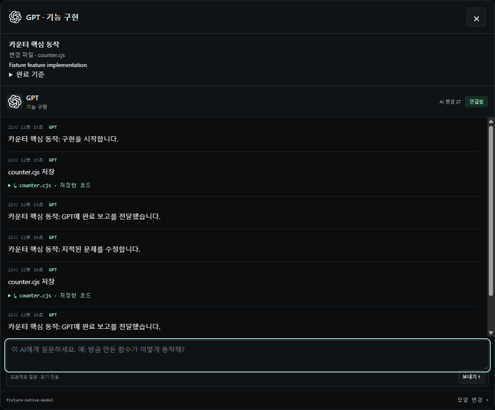

팝업에서 질문하면 그 AI가 현재 프로젝트와 자신의 대화 기록을 바탕으로 답합니다. 개별 질문은 읽기 전용이며, 파일 변경은 컨트롤 타워의 **작업 요청**으로 보냅니다. 팝업 오른쪽 위 **×** 또는 **Esc**로 닫습니다.

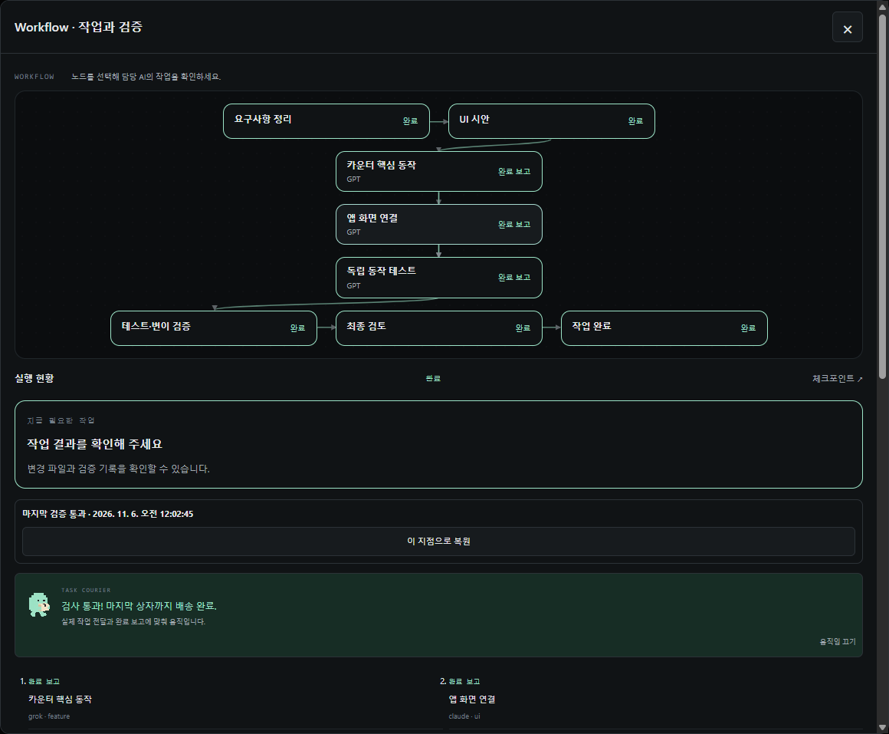

**완료 보고**는 담당 AI가 구현을 제출했다는 뜻입니다. **작업 완료**는 실행 검증과 최종 검토까지 통과했을 때 표시됩니다. 체크포인트를 복원하면 이전 검증 결과가 해제되어 다시 확인해야 합니다.

### 2. AI를 연결하고 역할 나누기

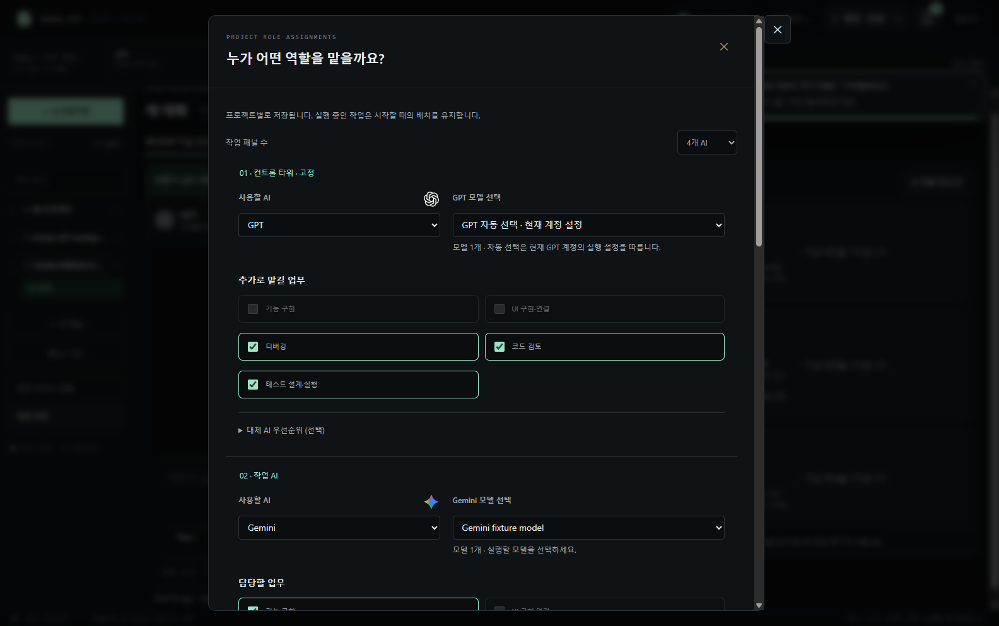

**계정 · 연결**에서 기존 로그인 상태를 확인하고, **AI 역할 변경**에서 실제 작업에 쓸 패널과 역할을 정합니다.

| 연결할 AI | 사용 방법 |
| --- | --- |
| GPT | 공식 Codex CLI의 ChatGPT 로그인 상태를 확인합니다. |
| Claude | 공식 Claude Code에 로그인합니다. |
| Grok | Cursor Agent CLI에 로그인하고, 계정에서 제공되는 Grok 모델을 선택합니다. |
| Gemini | Gemini CLI에서 Google 계정으로 로그인합니다. |

**작업 패널 수**는 2~4개로 정할 수 있습니다. 01번은 **컨트롤 타워**에 고정되며 AI는 바꿀 수 있습니다. **기능 구현**과 **UI 구현·연결**은 각각 한 패널만 맡습니다. **디버깅**, **코드 검토**, **테스트 설계·실행**은 중복 배정할 수 있습니다. 담당을 옮길 때는 기존 체크를 해제한 뒤 다른 패널에서 선택하세요.

| 기본 AI | 기본 업무 |
| --- | --- |
| GPT | 컨트롤 타워 + 디버깅 + 코드 검토 + 테스트 설계·실행 |
| Grok · Cursor | 기능 구현 + 디버깅 + 코드 검토 |
| Claude | UI 구현·연결 + 코드 검토 |

모델 목록은 **시작 창에서 미리 준비**합니다. **AI 역할 변경**을 열거나 사용할 AI를 바꾸면 준비된 목록을 즉시 표시합니다. **GPT 모델 선택**처럼 AI 이름을 표시하므로 실행할 모델을 바로 고를 수 있습니다. GPT·Claude의 **자동 선택**은 해당 계정의 현재 실행 설정을 따릅니다. Cursor·Gemini는 목록에서 모델을 선택하며, 이 앱에 저장한 모델이 목록에 있으면 먼저 표시합니다. 목록이 없거나 조회가 실패하면 연결 확인 안내를 표시합니다.

같은 계정을 여러 패널에 배치하면 사용 한도도 공유합니다. 실행 중 배치를 바꾸면 다음 작업부터 적용되며, 진행 중인 작업은 시작할 때의 배치를 유지합니다.

### 사용 한도가 소진될 때 대체 AI로 이어가기

대체 AI를 따로 지정하지 않아도 **현재 팀에 연결된 AI**에서 이어받을 대상을 찾습니다. 담당 역할, 확인 가능한 잔여 한도와 로그인·모델 준비 상태를 고려합니다. 예를 들어 GPT 40%, Cursor 소진, Claude 10%이고 기능 구현을 이어받을 때 역할 적합도가 같으면 GPT를 우선 확인합니다.

최근 2분 안에 확인한 공식 잔여 한도가 **5% 이하**이면 다음 요청 전에 여유 있는 팀 AI를 찾습니다. Cursor처럼 잔여 비율을 제공하지 않는 연결은 추정하지 않고 실제 한도 소진 오류가 있을 때 전환합니다. **대체 AI 우선순위 (선택)**를 펼치면 먼저 확인할 AI와 모델을 직접 정할 수도 있습니다.

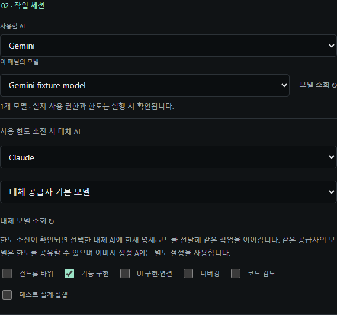

- 작업 ID·역할·명세·완료 기준·전달받은 소스와 대화 맥락을 유지합니다. 공급자 내부의 비공개 세션 자체를 옮기는 방식은 아닙니다.
- 대체 AI의 기존 로그인과 모델 연결을 확인한 뒤 실행합니다. 사용할 수 없으면 다른 팀 AI를 확인하고, 모두 사용할 수 없으면 저장된 코드를 보존한 채 사용자 확인 상태로 멈춥니다.
- 전환되면 해당 카드의 **로고·AI 이름·모델·대체 연결 표시**가 바뀝니다. 완료 후 개별 질문도 같은 대체 AI가 받으며, 새 작업은 설정한 기본 AI부터 시작합니다.
- 일시적인 요청 속도 제한·네트워크 오류·인증 만료·컨텍스트 길이 초과를 일반적인 한도 소진으로 간주해 전환하지 않습니다. 인식하지 못하는 오류는 로그와 함께 멈춥니다.
- 실패한 기본 호출과 대체 호출을 모두 호출 한도에 포함합니다. 같은 공급자의 다른 모델도 계정 한도를 공유할 수 있습니다. GPT 실행의 로그인/API 방식을 임의로 바꾸지 않으며 이미지 API 연결은 별개입니다.
- Cursor가 **UI 구현·연결**을 직접 또는 자동으로 맡게 되면 현재 권장 설정에서 추천하지 않는다는 안내와 **취소 / 이번 작업에서 진행**을 먼저 표시합니다. 이는 이 프로젝트의 사용자 선호를 반영한 권장 규칙이며, 모든 Cursor 모델의 객관적인 성능 평가를 뜻하지 않습니다.
- 응답 도중 끊긴 비공개 내부 세션이나 저장되지 않은 미완성 응답은 옮길 수 없습니다. 마지막 저장 코드와 명세·완료 기준을 같은 작업 요청으로 전달해 다시 이어갑니다.

인계 자료는 `.control-tower/runs/<작업 ID>/handoffs/`에 버전 있는 JSON으로 보관합니다. 명세·담당 작업·완료 기준·현재 파일 해시·이미 제출한 변경·체크포인트 참조·최근 대화와 사실·미해결 검증 결과를 다음 AI에게 전달합니다. 벤더의 비공개 메모리나 숨겨진 추론을 복사하는 기능은 아닙니다. 다음 AI는 전달된 기준과 실제 소스를 다시 확인하며, 적용 전에는 기존 변경 충돌 검사를 거칩니다.

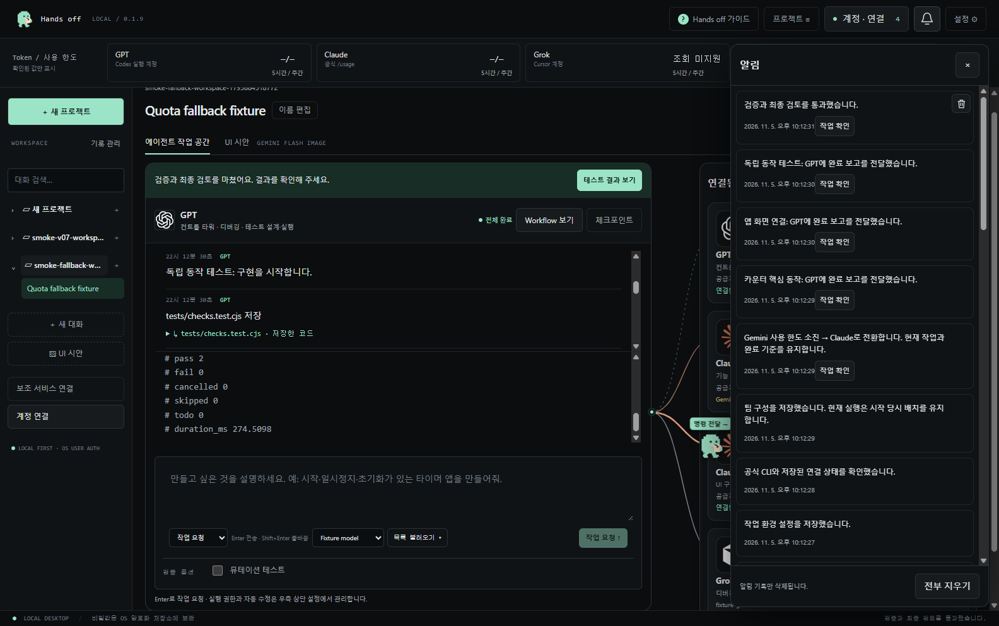

화면 알림은 약 10초 뒤 사라지고 **종 아이콘**에 기록으로 남습니다. 알림을 삭제해도 작업·대화·테스트 결과는 삭제되지 않습니다. 기록은 현재 OS 사용자의 앱 프로필에 최대 200개까지 보관합니다.

<details>
<summary>계정 연결과 작업자 화면 보기</summary>

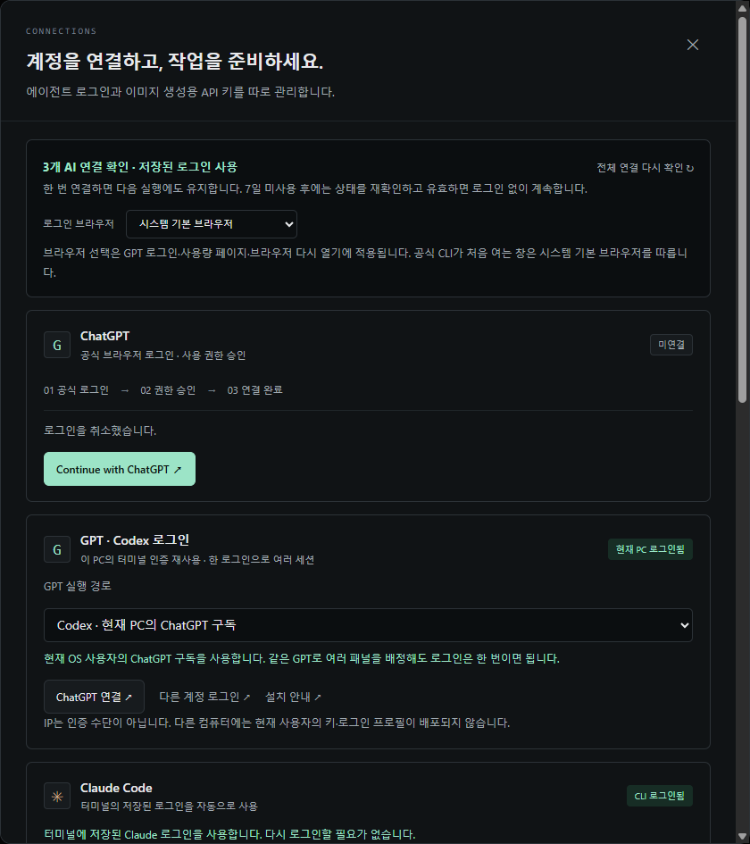

**전체 연결 다시 확인**을 누르면 공식 CLI 로그인 상태와 앱에 등록한 연결을 다시 조회합니다. UI 시안을 생성하려면 GPT Image 또는 Gemini 이미지용 개인 API 키를 등록합니다. 이미지 API 사용량과 비용은 해당 공급자 계정에 따로 반영됩니다.

</details>

### 3. UI 시안을 확인하고 수정하기

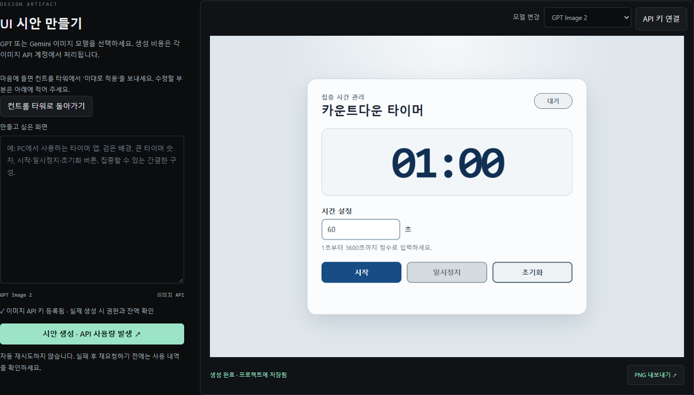

UI 작업이 포함되고 시안 승인 설정이 켜져 있으면, 기본적으로 **이미지 API를 호출하지 않는 텍스트 구조안**을 보여주고 승인을 기다립니다. 박스를 든 캐릭터가 왼쪽 **UI 시안**으로 안내합니다. 구조안은 설계의 화면 구성·상태·스타일과 수정 요청을 읽는 미리보기이며, 완성 화면 이미지라고 표시하지 않습니다.

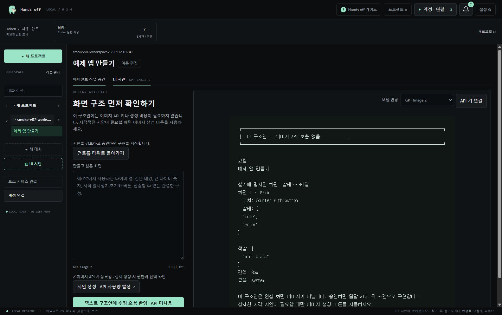

- 왼쪽 **UI 시안**, 컨트롤 타워의 안내 버튼, 종 알림의 **시안 확인** 중 편한 곳을 누릅니다. Workflow의 **UI 시안** 노드에서도 열 수 있습니다.
- 구조만 확인하려면 **텍스트 구조안에 수정 요청 반영**을 사용합니다. 이미지 API 호출은 없습니다.
- 시각적인 시안이 필요할 때 **모델 변경**에서 GPT Image 또는 Gemini Flash Image를 선택하고 **시안 생성 · API 사용량 발생**을 누릅니다. 이때만 이미지 API 키와 비용이 필요합니다. 설정에서 기본 형식을 이미지로 직접 바꿀 수도 있습니다.
- 입력란에 “시간 숫자를 더 크게”처럼 바꿀 내용을 적고 **시안 생성**을 누릅니다. 컨트롤 타워에서도 `시안 수정: 시간 숫자를 더 크게`라고 보낼 수 있습니다.
- 마음에 들면 **컨트롤 타워로 돌아가기**를 눌러 `이대로 적용`을 보냅니다. 파일로 보관할 때는 **PNG 내보내기**를 사용합니다.

### 4. 테스트 결과를 읽고 필요하면 복원하기

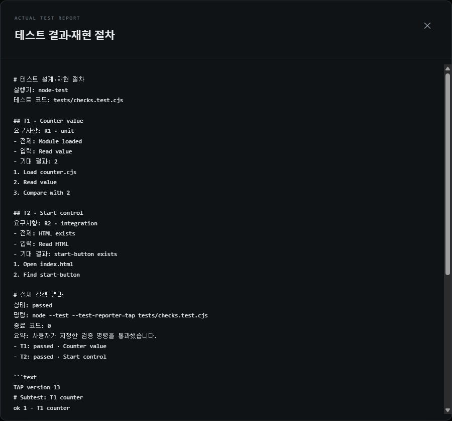

**테스트 설계·실행** 역할을 배정하면 요구사항을 실제 테스트 코드와 연결하고 재현 절차를 남깁니다. 실행 권한을 승인한 폴더에서는 Node 내장 테스트나 지정한 npm 스크립트로 결과를 확인합니다. 실패 항목과 담당 AI는 **Workflow 보기**에서 확인합니다. 컨트롤 타워는 **설정 → 자동 수정 최대 횟수** 안에서 수정과 재실행을 요청합니다. 같은 실패가 반복되거나 테스트 자체에 문제가 있다고 판단되면 사용자 확인 상태로 멈춥니다. 실행 권한이 필요하면 대화 위 안내 버튼으로 설정을 엽니다.

- **결과·재현 절차**에서 각 테스트의 결과와 실행 명령을 확인합니다. 필요한 경우 **테스트 다시 실행**을 누릅니다.
- AI 연결이나 구현 도중 중단되면 **문제 작업 출력 보기**로 담당 AI의 로그와 변경 내역을 확인합니다.
- **체크포인트**에서 복원 지점과 영향을 받을 파일을 미리 봅니다. 사용자가 이후 수정한 파일과 충돌하면 복원을 멈춥니다.
- 기본 완료 기준은 계획한 일반 테스트 실행과 검토입니다. 패키지를 자동 설치하지 않으며, Node 내장 테스트나 프로젝트의 npm 테스트 스크립트를 사용합니다.
- **고급 검증 옵션 → 뮤테이션 테스트**는 기본 선택을 해제했습니다. StrykerJS와 프로젝트의 `test:mutation`·JSON 보고 설정을 갖춘 경우 선택하세요. 선택했는데 미설정이면 통과로 표시하지 않습니다. 자주 사용하는 프로젝트라면 설정에서 새 작업의 기본 선택을 켤 수 있습니다.

<details>
<summary>체크포인트와 실행 권한 화면 보기</summary>

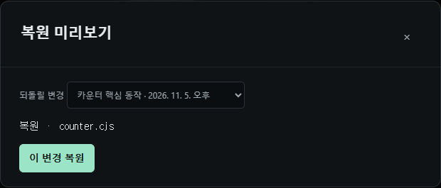

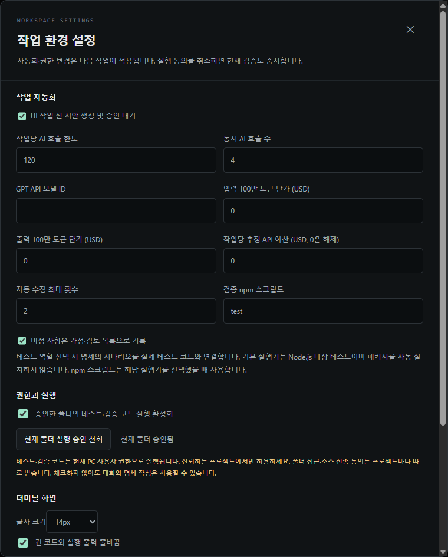

</details>

### 5. GitHub로 푸시하거나 Vercel에 배포하기

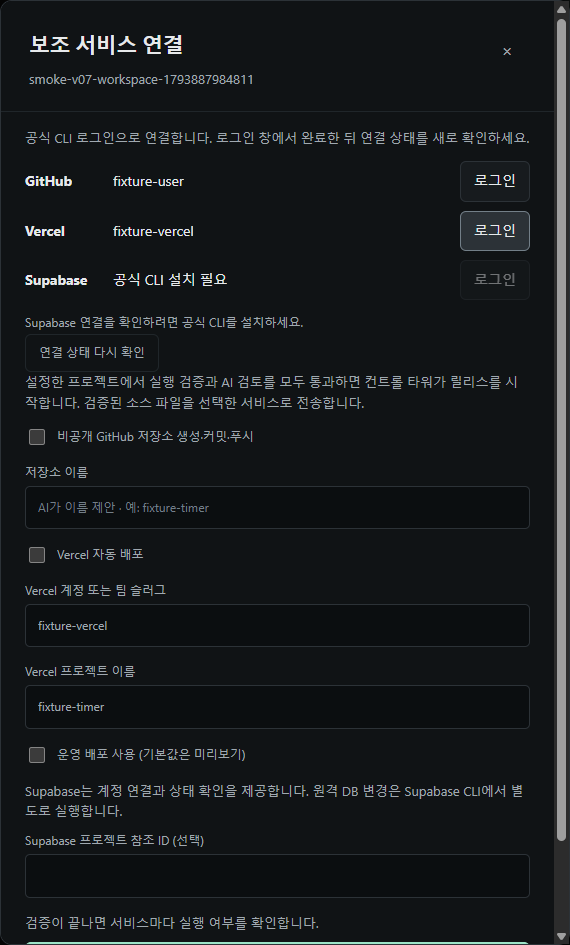

왼쪽 아래 **보조 서비스 연결**에서 공식 CLI 로그인 상태를 확인하고, 필요한 서비스만 현재 프로젝트에 설정합니다.

| 서비스 | 설정하면 할 수 있는 일 |
| --- | --- |
| GitHub | 검증된 코드를 커밋·푸시합니다. 새 저장소가 필요하면 이름을 정하거나 컨트롤 타워의 제안을 받아 비공개 저장소를 만들 수 있습니다. |
| Vercel | 연결한 계정 또는 팀의 프로젝트에 미리보기로 배포합니다. 운영 배포는 따로 선택합니다. |
| Supabase | 계정 연결을 확인하고 프로젝트 참조 ID를 저장합니다. 프로젝트 연결과 DB 마이그레이션은 Supabase CLI에서 진행합니다. |

검증이 끝나면 앱이 **전송 대상**과 함께 진행 여부를 묻습니다. **예**는 이번 작업을 전송하고, **아니요**는 해당 서비스만 건너뜁니다. **다음부터 묻지 않기**는 같은 프로젝트와 같은 대상에서만 적용되며 설정에서 해제할 수 있습니다. 네트워크 오류가 나면 로컬 작업을 확인하고 실패한 전송 단계만 다시 시도할 수 있습니다.

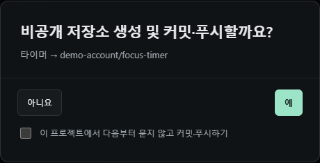

## 실행 권한과 데이터

프로젝트 파일은 선택한 폴더에 저장됩니다. AI가 작업에 필요한 소스를 읽거나 전달하는 범위는 폴더 연결 시 확인할 수 있습니다. 앱에 등록한 API 키는 OS 보안 저장소로 암호화하고, 공식 CLI 로그인은 현재 OS 사용자의 세션을 재사용합니다.

테스트·빌드의 기본 실행 위치는 **Docker**입니다. `.env`·인증 폴더·로그인·호스트의 `node_modules`를 제외한 복사본만 읽기 전용으로 전달합니다. 컨테이너의 작업 공간은 메모리 파일 시스템이며 네트워크, 권한 상승, 호스트 쓰기 마운트와 Docker 소켓을 제공하지 않습니다. CPU·메모리·프로세스 수와 실행 시간을 제한하고, 변이 결과 JSON만 크기를 제한해 돌려받습니다. 준비되지 않으면 검증을 보류합니다.

기본 Node 이미지는 `docker pull node:24-bookworm-slim`으로 미리 준비합니다. 라이브러리가 필요한 프로젝트는 `/opt/node_modules`에 의존성을 준비한 별도 이미지를 지정해야 합니다. 격리 중에 패키지를 자동 다운로드하지 않습니다. Docker Desktop의 이용 조건은 개인·조직 환경에 따라 확인하세요. [Docker 공식 라이선스 안내](https://docs.docker.com/subscription/desktop-license/)

설정에서 **현재 PC**를 선택하면 별도 경고·동의를 받습니다. 이 방식은 현재 OS 사용자 권한으로 실행되므로 신뢰하는 폴더에서만 사용하세요. Docker도 호스트 커널·엔진 취약점까지 제거한다고 보장하지 않습니다. 앱·파일 적용·공식 로그인은 호스트에서 처리하고, 프로젝트의 테스트·빌드 실행을 격리하는 구조입니다. [보안과 릴리스 검증 절차](docs/security-release.md)

대체 AI를 설정하면 동일한 작업 자료가 선택한 다른 공급자에게 전달될 수 있습니다. 공유가 허용되는 프로젝트에서 연결하세요. 저장소와 배포 파일에는 개발자의 로그인 프로필·키 저장소를 포함하지 않습니다. 연결 상태는 실행한 컴퓨터의 OS 사용자 환경에서 새로 확인합니다.

## 최근 업데이트와 확인 범위

| 업데이트 | 달라진 점 |
| --- | --- |
| 시작 준비 | 별도 흰색 시작 창에서 프로젝트·연결·모델 목록을 준비합니다. 계정 설정·역할 설정·채팅에서 준비된 목록을 사용합니다. |
| 화면 로딩 복구 | 일시적인 `ERR_FAILED (-2)`·`ERR_ABORTED`는 최대 2회 재시도합니다. 문서 로딩과 앱 초기화가 끝난 뒤 작업 창을 표시합니다. |
| 역할과 자동 인계 | 기본 역할, 단일 구현 담당, 복수 검토 역할과 2~4개 패널을 지원합니다. 사용 한도가 소진되면 연결된 팀 안에서 이어받을 AI를 확인합니다. |
| 검증과 복원 | 테스트·재현 절차, 뮤테이션 검사 연결, 변경 충돌 확인, 체크포인트 미리보기와 복원을 제공합니다. |
| 이용 조건 | 무료 비상업적 실행과 별도 승인이 필요한 코드 수정·상업적 이용·모델 학습을 구분했습니다. 배포 패키지에도 LICENSE와 NOTICE를 포함합니다. |
| 첫 실행 설치 안내 | 필요한 도구와 Node 버전, Docker 엔진·이미지를 확인하고 공식 설치 페이지로 안내합니다. |
| 호출·비용 제한 | 작업·일일 호출 수와 일일 이미지 횟수를 호출 전에 확인합니다. 텍스트 API는 최대 출력 토큰과 설정 단가를 이용해 비용을 먼저 예약합니다. |
| 플랫폼별 배포 | Window·Mac 저장소에 같은 소스를 동기화하고 Windows x64, Mac arm64·x64에서 각각 빌드·검증합니다. |

AI 응답과 계정은 테스트용으로 격리하고 실제 Electron 창·파일 처리·검증 프로세스로 확인합니다. 설치 안내와 호스트 실행 거부·승인, 비용 예약 경쟁, 대체 AI, 시안 승인과 체크포인트도 검사합니다. 플랫폼별 실제 실행 결과와 아직 확인하지 못한 부분은 [VALIDATION.md](VALIDATION.md)에 구분해 기록합니다. 새 계정의 로그인 승인이나 모든 공급자의 유료 추론을 전부 실험한 결과는 아닙니다.

AI가 제출한 코드에 오류가 없다고 보장하지 않습니다. 공식 CLI의 지원 모델·사용 한도와 네트워크에 따라 연결 결과가 달라질 수 있고, 선택한 뮤테이션 검사가 미설정이면 통과로 간주하지 않습니다. Windows 포터블은 코드 서명이 적용되지 않았으며 Mac은 Developer ID 서명·공증이 없습니다. Supabase 연결은 계정 확인과 프로젝트 참조 ID 관리까지 제공하며 DB 마이그레이션은 별도로 진행합니다.

## 라이선스와 이용 승인

저작권자: **Chan Woo Cho · ccw00325-spec**

승인 문의: **[ccw00325@gmail.com](mailto:ccw00325@gmail.com)**

0.2.3부터 프로젝트 고유 자료에 **Hands off System Permission License 1.0**을 적용합니다. Apache-2.0이 아닌 전용 소스 공개 라이선스입니다.

- **바로 사용:** 개인·학습·비상업적 연구 목적으로 수정하지 않은 앱을 실행하고, 소스를 그대로 빌드하고, 앱 설정과 자신의 프로젝트 파일을 변경할 수 있습니다.
- **서면 승인 후 사용:** Hands off 원본 코드·내장 스킬·프롬프트의 수정과 파생 개발, 판매·유료 고객 작업·회사 상업 업무·SaaS·광고 등 수익화 목적 이용, 프로젝트 자료를 이용한 모델 학습·파인튜닝·증류입니다. 매출이 나기 전의 상업적 이용도 포함합니다.
- **출처 보존:** 허용된 원본 재배포에는 `Chan Woo Cho (ccw00325-spec)`와 저장소 링크, LICENSE·NOTICE를 함께 보존해야 합니다. 이름을 적는 것만으로 승인 대상 행위를 허용하지는 않습니다.

메일로 사용 목적과 변경·배포·학습 범위를 보내고, 저작권자가 명시적으로 승인한 답신이나 서면 계약을 받아 주세요. 사용자 입력과 독립적인 생성물의 소유권을 앱이 가져오지는 않습니다. 제삼자 구성 요소는 각자의 라이선스를 따릅니다. [전체 LICENSE](LICENSE) · [한국어 이용 조건과 승인 요청 양식](docs/licensing.md) · [변경 제안 안내](CONTRIBUTING.md)

정식 저장소의 수정 권한과 외부 복사본은 다릅니다. 공개 저장소의 열람·포크나 외부 PC의 파일 수정 자체를 기술적으로 막지는 못합니다. 이 앱은 상업적 사용을 감시하거나 저작권자에게 자동 신고 이메일을 보내지 않습니다. 이용 조건은 라이선스로 고지하며, 집행 가능성은 구체적인 사안에 따른 법률 검토가 필요합니다.

<details>
<summary>직접 빌드와 개발 검증</summary>

Windows에서 포터블 빌드를 만들면 `release/CW_Handsoff_sys 0.2.4.exe`가 생성됩니다.

```powershell
npm run package:win -- --config.compression=store
npm run check
npm test
npm run test:desktop
node scripts/check-startup.mjs
node scripts/check-startup-recovery.mjs
npm run verify:package
```

데스크톱 테스트는 예시 응답으로 버튼과 작업 흐름을 검사합니다. `test:timer:live`, `test:timer:qa:live`, `test:chat:live`는 실제 계정 사용 한도를 소비합니다. [검증 기록](VALIDATION.md) · [배포 관리 규칙](docs/release-policy.md)

Ubuntu x64에서 소스로 실행하려면 Linux용 Node.js와 npm, Electron GUI 런타임을 준비한 뒤 `npm ci`, `npm run check`, `npm test`, `npm start`를 실행합니다. AI CLI는 해당 Linux 사용자 환경에서 연결합니다.

</details>

AI 공급자 아이콘은 [Lobe Icons](https://github.com/lobehub/lobe-icons)의 MIT 라이선스 SVG를 앱에 포함해 사용합니다. 실행 중 외부 아이콘 서버로 요청하지 않습니다. [출처와 라이선스](src/renderer/assets/providers-NOTICE.txt)

<details>
<summary>고급 검증과 호출 한도</summary>

- **StrykerJS**는 프로젝트의 `test:mutation`을 `stryker run`에 연결합니다. `reporters`에 `json`을 추가하고, `jsonReporter: { fileName: process.env.TOWER_MUTATION_REPORT }`로 앱이 전달한 위치에 결과를 씁니다. `thresholds.break`는 `null`로 두고 `mutate`에는 핵심 로직을 지정합니다. PR 변경 파일만 검사하려면 프로젝트 스크립트에서 범위를 계산하세요.
- **호출 제한**은 작업별·하루 전체·하루 이미지 횟수를 호출 전 공유 원장에서 확인합니다. 프로젝트·질문·대체 AI 호출도 포함하며 동시 요청이 같은 잔여 횟수를 중복 사용하지 못하게 직렬화합니다. 하루 기준은 UTC이고 앱 재시작 후에도 유지합니다. 사용자 계정 전체나 다른 PC·다른 앱의 호출까지 통제하지는 않습니다.
- **일일 한도를 변경하면** 진행 중인 작업의 새 호출에도 현재 한도를 적용합니다. 저장된 테스트를 다시 실행할 때도 현재 선택한 Docker/PC 실행 위치를 따르며, 과거 세션의 호스트 설정으로 몰래 돌아가지 않습니다.
- **텍스트 API 예산**은 설정한 모델 단가, 입력 바이트와 최대 출력 토큰을 기준으로 사전 예약합니다. 예약이 예산을 넘으면 호출하지 않으며 사용량을 확인하지 못하면 예약을 보존합니다. 공급자의 실제 청구 상한을 보증하는 장치는 아닙니다. 비용을 측정하지 못하는 이미지 입력·생성은 금액 예산을 켰을 때 차단합니다. CLI 구독의 잔여 토큰을 임의로 달러로 계산하지 않습니다. 한도에 도달하면 설정에서 검토하고 명시적으로 변경한 뒤 다시 시작하세요.
- **변경 보호**는 위험한 파일 변경을 적용하기 전에 별도 검토하고, 기준 파일이 달라지면 적용을 보류합니다. 체크포인트 복원은 로컬 파일에 적용되며, 복원 이후 검증과 배포 승인은 다시 받아야 합니다. 프로젝트에서 Git을 사용한다면 `.control-tower/`를 버전 관리에서 제외하세요.

</details>

Mac에서 직접 빌드할 때는 `npm run package:mac -- --arm64` 또는 `--x64`를 사용하고 `node scripts/verify-package.mjs --mac --arch=arm64`처럼 검사합니다. macOS에서만 실행하는 네이티브 패키지 검사는 `node scripts/check-packaged-mac.mjs --arch=arm64`입니다. 유지보수자는 검증한 변경을 커밋한 뒤 `npm run sync:platforms`로 두 저장소에 같은 커밋을 푸시합니다.
